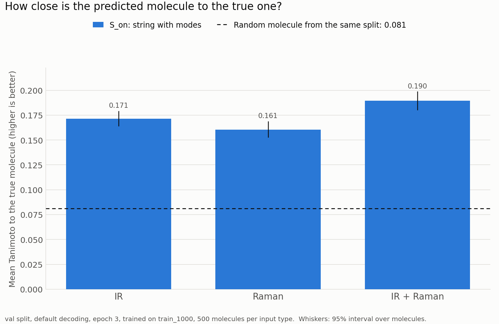
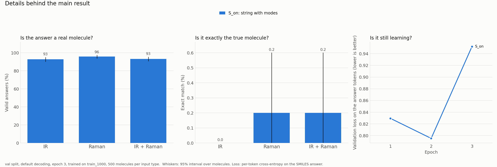

[← Back to the overview](../README.md) · [Part 1: Strings](../1_strings/README.md) · [Part 2: Bitstream](../2_bitstream/README.md) · Part 3 of 3

# 3 · Audio tokeniser: can a speech model read a spectrum as a spectrogram?

> **Status: in progress.** Only the baseline arm (`S_on`) has finished, on the quick pass (1,000 training molecules). The audio arms are training now. The numbers below are preliminary.

In [Part 1](../1_strings/README.md), the model did much better when every peak carried a vibrational mode label. Those labels come from a DFT calculation, so real spectra do not have them. This part asks whether a model can read the spectrum itself, as a spectrogram, through the audio encoder of a speech model, and whether that view adds to the string or can replace the mode labels.

The backbone is [Step-Audio-2-mini](https://huggingface.co/stepfun-ai/Step-Audio-2-mini): a Qwen2.5-7B-based language model with an audio encoder and an adaptor. Its encoder reads a [128, T] array, the shape of a log-mel spectrogram. We write the spectrum straight into that shape; no sound file is made.

![Pipeline: the spectrum becomes a [128, T] array, goes through the audio encoder and adaptor, and joins the text prompt in the language model](figures/pipeline.svg)

## Arms

Same molecules, splits, system prompt, answers, training recipe and batch order as Part 1. Only the user turn changes.

| Arm | String in the prompt | Audio | Question it answers | Status |
|---|---|---|---|---|
| `S_on` | `components_v3` with mode labels | none | Baseline on the new backbone | Done (quick pass) |
| `AUD` | none | IR / Raman view | Can the model read the spectrogram at all? | Training |
| `S_on_AUD` | `components_v3` with mode labels | yes | Does audio add to the full string? | Next |
| `S_off_AUD` | `components_v3`, no mode labels | yes | Can audio replace the mode labels? | Next |

Registered for later: `S_off` (the string without labels, the baseline for `S_off_AUD`), `A` (SpectraLLM's layout), and two controls that give each molecule another molecule's spectrogram, to test whether the model uses the audio at all.

## Preliminary result: the baseline `S_on`

Quick pass: 1,000 training molecules (3,000 prompts), 3 epochs. Validation set: 500 molecules per kind of spectrum. Sampling decoding (temperature 0.6, top-k 20, top-p 0.95), one sample per molecule.

| Spectra | Tanimoto (invalid = 0) | 95% interval | Valid SMILES | Exact match |
|---|---|---|---|---|
| IR | 0.171 | 0.164 to 0.179 | 92.8% | 0.0% |
| Raman | 0.161 | 0.153 to 0.168 | 95.8% | 0.2% |
| IR+Raman | 0.190 | 0.181 to 0.199 | 93.2% | 0.2% |

A random molecule from the same split scores 0.081.

- **It learns the task.** All three scores are about twice the random floor.
- **Not comparable with Part 1.** On the same validation prompts, the Qwen3-8B model with the same string reaches 0.357 on IR+Raman. But it was trained on 10 times as many molecules, with a different base model, tokenizer and training code. `S_on` is the baseline for the audio arms only.
- **Three epochs is too many at this size.** Validation loss fell from epoch 1 to 2 and rose at epoch 3 (0.83, 0.80, 0.95). The numbers above use epoch 3, the rule applied to every arm. In Part 1, with 10,000 molecules, validation loss was still falling at epoch 3.

## The view: a sliding window along the spectrum

![One molecule's IR and Raman spectra, and their [128, 814] views with log and linear scaling](figures/audio_view_example.png)

Each frame of the [128, T] array holds 128 consecutive points of the spectrum, and the window moves 2 points per frame. A peak at point *p* sits in channel *p* − 2*t* of frame *t*, so every peak draws a diagonal line (dashed in the figure).

| Setting | Value | Why |
|---|---|---|
| Spectrum | 3,501 points, 500–4000 cm⁻¹ | The QM9S broadened IR and Raman files |
| Decimation | 2 (2 cm⁻¹ per point) | Peaks are 10–15 cm⁻¹ wide, so nothing is lost. The window spans 256 cm⁻¹ |
| Hop | 2 points (4 cm⁻¹) per frame | 814 frames per spectrum |
| Scaling | log, 4 decades, mapped to −0.5 to 1.5 | The value range of log-mel input |
| Cost | 102 tokens per spectrum, 204 for IR+Raman | After the encoder (÷ 4) and the adaptor (÷ 2) |

Two open questions about the view:

- **Scaling.** Log scaling lifts the Lorentzian tails into a broad haze; linear scaling gives clean streaks, but weak peaks almost vanish. If `AUD` does badly with log scaling, it will be rerun with linear scaling before drawing a conclusion.
- **A channel has no fixed wavenumber.** The model must combine channel and frame to find a position, and the frozen encoder was trained on speech, which has no sharp lines at one fixed slope. Whether it passes this information on is what `AUD` tests.

## Prompt length

Mean tokens per training example (Step-Audio tokenizer; system prompt, prompt and answer).

| Arm | Mean | 95th percentile | Max |
|---|---|---|---|
| `AUD` | 366 | 457 | 463 |
| `S_on` | 1,096 | 1,946 | 2,478 |
| `S_on_AUD` | 1,333 | 2,246 | 3,050 |

`S_on_AUD` is measured on the 10,000-molecule split; the others on the 1,000-molecule split.

## Design

- **Model.** Step-Audio-2-mini. The audio encoder (637M parameters) is frozen. The adaptor (14.9M) is trained in full, and the language model gets LoRA, rank 16, alpha 32, on all 196 attention and MLP projections. 55.3M trainable parameters in all.
- **Recipe.** As in Part 1: learning rate 1e-4, 5% warm-up then cosine decay, 3 epochs, effective batch 16, loss on the answer tokens only, seed 20261001. Hugging Face and PEFT, on one L40S.
- **Prompt.** Step-Audio's own chat format. In the audio arms the string is unchanged, and the spectrogram goes just before the final instruction. `AUD` has no peak list, no counts and no mode labels.
- **Data checks.** The spectra are joined to molecules through the molecule table, and every cached spectrum is checked against the peak lists in the prompts before training (IR 424 of 424 and Raman 259 of 259 peaks found).
- **Metrics.** The definitions of Part 1. The test set is used once, at the end.

## Next

- Finish `AUD`, `S_on_AUD` and `S_off_AUD` on the quick pass, then run all four on 10,000 molecules.
- Run the shuffled-audio controls and `S_off`.
- Compare with sonification, a second way to turn a spectrum into audio (each peak becomes a decaying tone).
- Apply the same view to EC-SERS, where spectra change over time, which suits an audio model better.

## Files in this folder

Results and outputs only; no code.

| File | What it holds |
|---|---|
| `results/S_on_train1000_val_results.csv` | The `S_on` table, with 95% intervals for every number |
| `results/S_on__train_1000/` | Run manifest (settings, validation loss per epoch, runtime) and every generated SMILES on validation |
| `results/token_stats/` | Prompt lengths per arm |
| `figures/` | The figures on this page |
