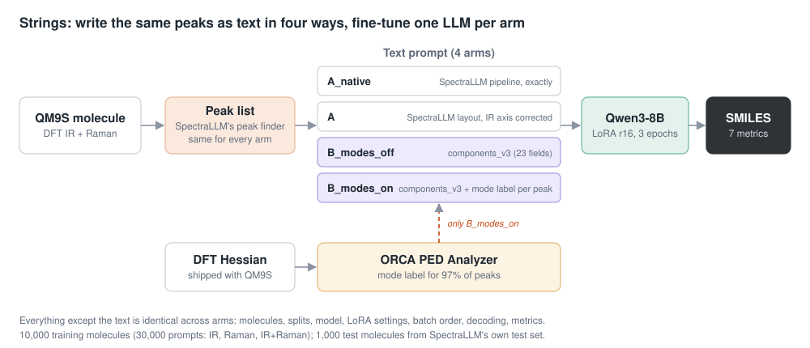
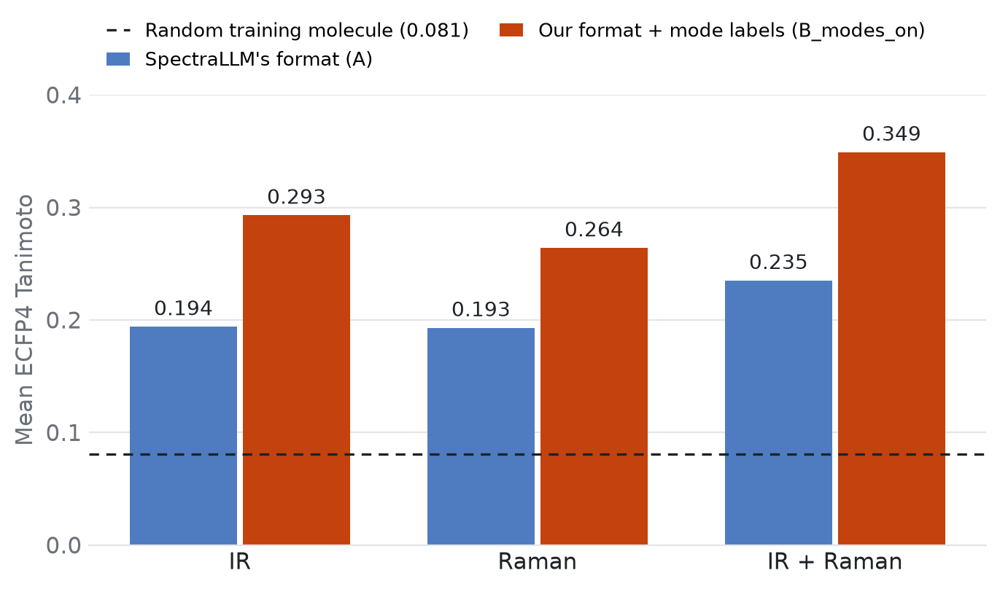
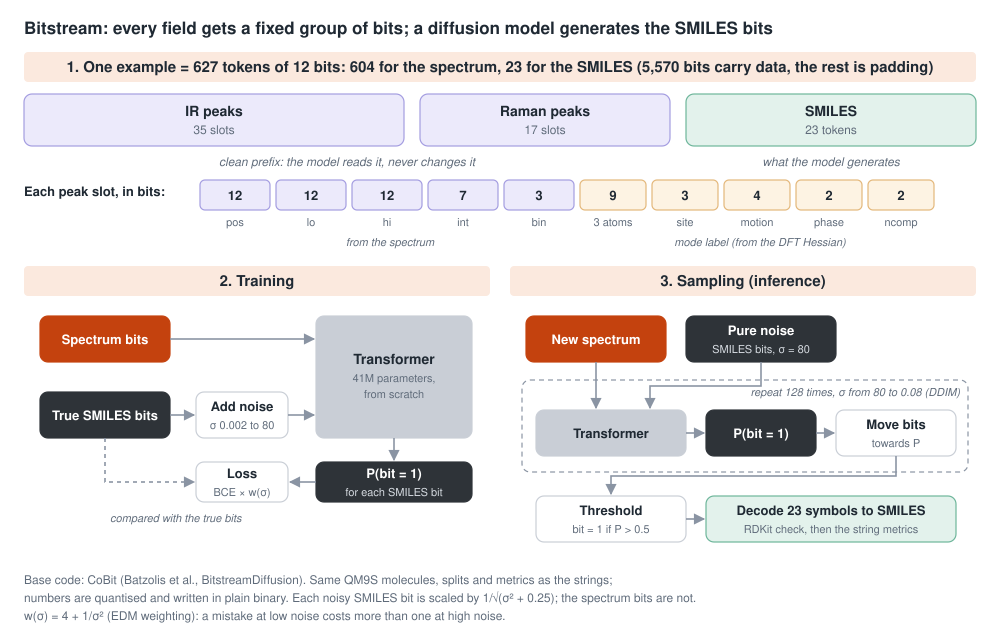
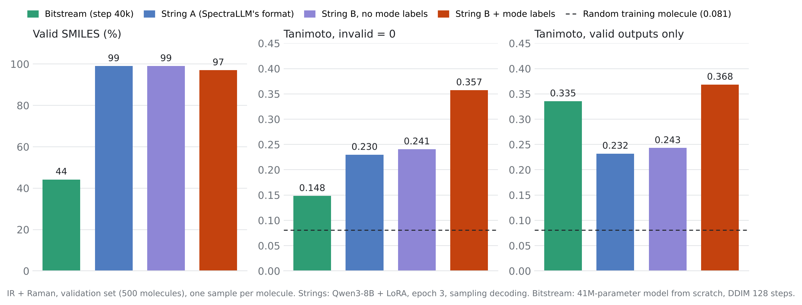
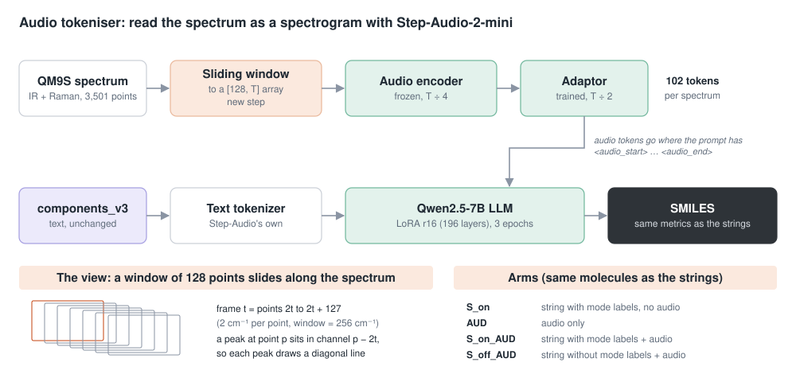

# spectral tokenisers

**How should a spectrum be written for a model that predicts molecular structure?**

We compare three ways to represent IR and Raman spectra, on the QM9S benchmark used by [SpectraLLM](https://arxiv.org/abs/2508.08441): as **text** for a fine-tuned LLM, as **fixed-width bit fields** for a diffusion model, and as a **spectrogram** for the audio encoder of a speech model. Every part uses the same molecules, splits and metrics, so the parts can be read side by side.

| Part | Representation | Model | Headline (IR+Raman, mean ECFP4 Tanimoto) | Status |
|---|---|---|---|---|
| [1 · Strings](1_strings/README.md) | Text, four formats | Qwen3-8B + LoRA | 0.349 with mode labels, against 0.235 for SpectraLLM's format (test set) | Done |
| [2 · Bitstream](2_bitstream/README.md) | Fixed-width bit fields | Bit diffusion (CoBit), 41M, from scratch | 0.148, or 0.335 on valid outputs only, against 0.357 for the best string (validation set) | First results |
| [3 · Audio tokeniser](3_audio/README.md) | Spectrogram, sliding window | Step-Audio-2-mini + LoRA | Baseline 0.190 on 1,000 training molecules; audio arms training | In progress |

Tanimoto compares the predicted and the true molecule: 0 means no substructures in common, 1 means the same molecule. A random training molecule scores 0.081. An invalid output scores 0.

---

## 1 · Strings: does a richer text format help?



The same peak list is written as text in four ways, and one Qwen3-8B model is fine-tuned per format. Only the text changes.



- **Our full string beats SpectraLLM's format** on all three kinds of spectra. On IR+Raman, Tanimoto rises from 0.235 to 0.349 (+0.114, 95% interval +0.098 to +0.130), and exact matches from 1.8% to 8.1%.
- **About 90% of the gain comes from the vibrational mode labels** (+0.102). The format alone adds +0.012.
- **The labels come from DFT.** Real spectra do not have them, which motivates Parts 2 and 3.
- 1,000 test molecules from SpectraLLM's own test set; one training run per arm.

[Full results, design and comparison with SpectraLLM's published numbers →](1_strings/README.md)

---

## 2 · Bitstream: can a diffusion model read fixed-width bit fields?



Each field of the string gets a fixed group of bits. A bit diffusion model reads the spectrum bits as a clean prefix and generates the SMILES bits.



- **On the benchmark metric, the bits lose:** 0.148 on IR+Raman, against 0.357 for the string with mode labels, because only 44% of outputs are valid SMILES (97% to 99% for the strings).
- **When the output is valid, it is close to the best string:** 0.335 against 0.368, and above both strings without mode labels.
- **The failures are SMILES grammar** (unclosed rings, unmatched brackets), not chemistry. The model memorises training molecules (97.7% exact) but does not yet generalise (2.4% on validation).
- Validation set, 500 molecules; the model has 41M parameters and starts from zero, where the strings fine-tune a pretrained 8B LLM.

[Full results, bit layout and failure analysis →](2_bitstream/README.md)

---

## 3 · Audio tokeniser: can a speech model read a spectrogram?



The spectrum is cut into overlapping windows and written as a [128, T] array, the shape of a log-mel spectrogram. Step-Audio-2-mini's audio encoder reads it, and the result joins the text prompt in its language model.

- **In progress.** The baseline `S_on` (the full string, no audio) reaches 0.190 on IR+Raman after training on 1,000 molecules, more than twice the random floor.
- **Next:** the audio-only arm `AUD` (can the model read the spectrogram at all?), then the string plus audio, with and without mode labels (can audio replace the labels?).

[Design, arms and the view →](3_audio/README.md)

---

## Shared setup

- **Data.** [QM9S](https://www.nature.com/articles/s43588-023-00550-y): 129,817 small organic molecules with DFT-computed IR and Raman spectra; 122,633 pass checks. 10,000 training, 500 validation and 1,000 test molecules, aligned with SpectraLLM's split. Each molecule is tested with IR, Raman and IR+Raman.
- **Targets.** Stereo-free canonical SMILES.
- **Metrics.** SpectraLLM's seven metrics, reimplemented; primary: ECFP4 Tanimoto (Morgan radius 2, 2,048 bits) on IR+Raman.
- **Hardware.** One NVIDIA L40S (48 GB).

## Repository layout

Results and outputs only; no code. QM9S itself and model weights are not redistributed.

```
1_strings/     text formats vs SpectraLLM: molecules, splits, peak assignments, predictions, test metrics
2_bitstream/   bit-field diffusion: validation metrics, generations, run configuration
3_audio/       Step-Audio-2-mini arms: preliminary baseline, view, prompt lengths
```

Each folder has its own README with the full results and a list of its files.

## References

- SpectraLLM: [arXiv:2508.08441](https://arxiv.org/abs/2508.08441)
- QM9S: Zou et al., [Nature Computational Science (2023)](https://www.nature.com/articles/s43588-023-00550-y)
- CoBit / BitstreamDiffusion: Batzolis et al., [github.com/GBATZOLIS/BitstreamDiffusion](https://github.com/GBATZOLIS/BitstreamDiffusion)
- Step-Audio 2: [arXiv:2507.16632](https://arxiv.org/abs/2507.16632); model: [stepfun-ai/Step-Audio-2-mini](https://huggingface.co/stepfun-ai/Step-Audio-2-mini)
