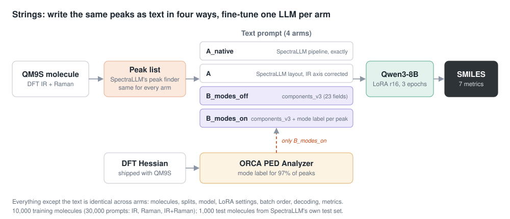
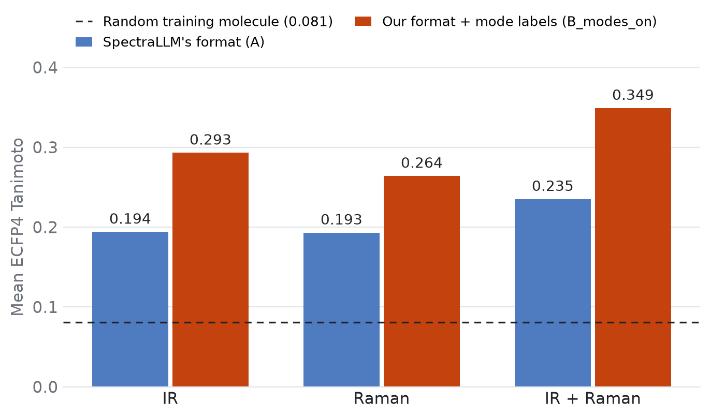
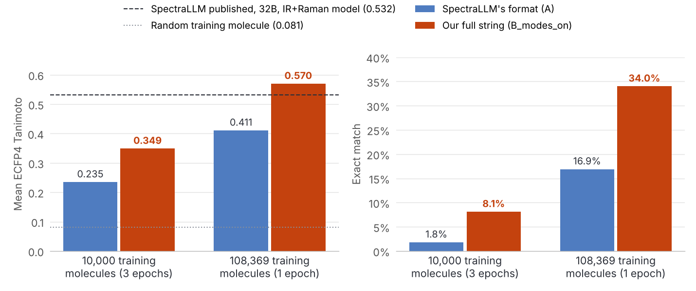
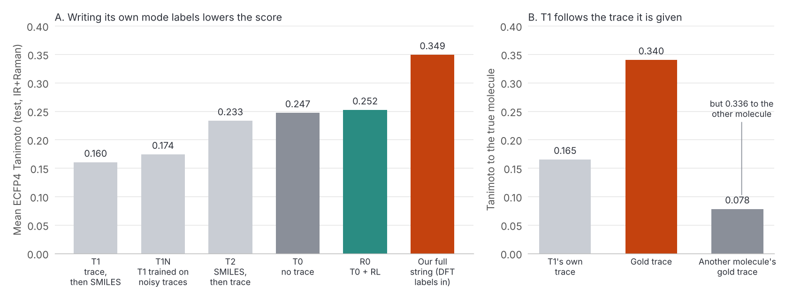
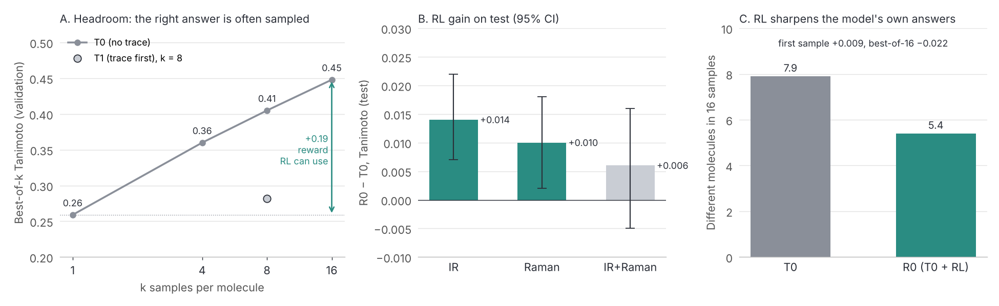
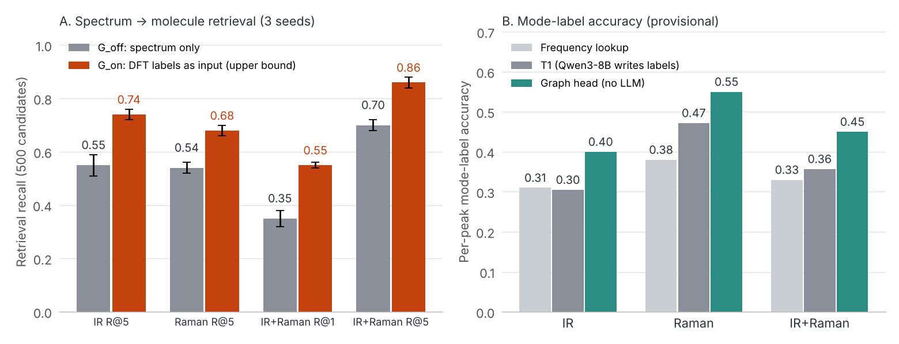
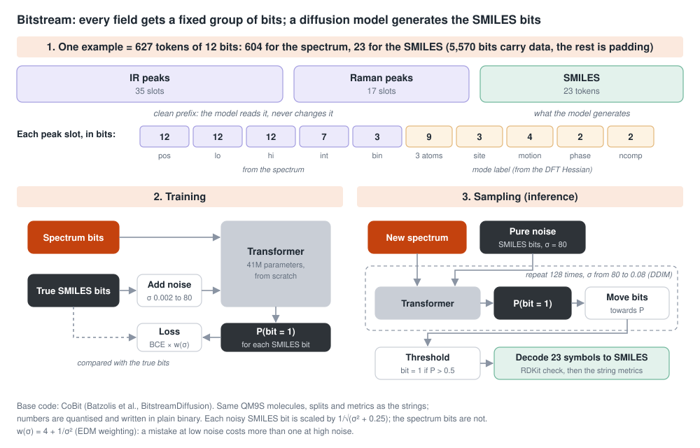
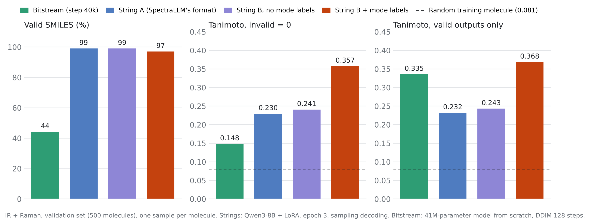
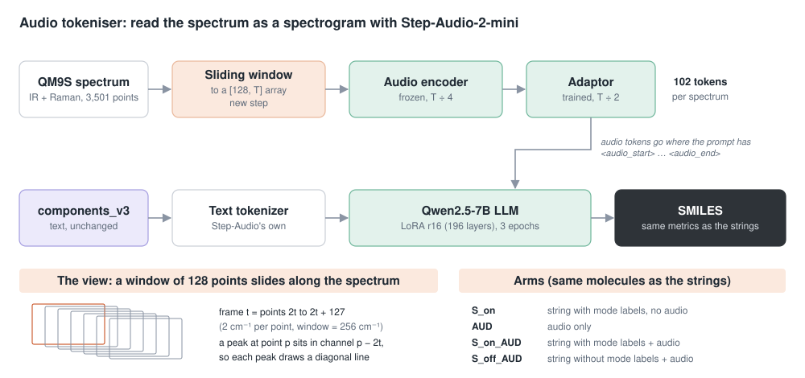

# spectral tokenisers

**How should a spectrum be written for a model that predicts molecular structure?**

We compare ways to represent IR and Raman spectra, on the QM9S benchmark used by [SpectraLLM](https://arxiv.org/abs/2508.08441): as **text** for a fine-tuned LLM, as **fixed-width bit fields** for a diffusion model, and as a **spectrogram** for the audio encoder of a speech model. Every part uses the same molecules, splits and metrics, so the parts can be read side by side.

The text result has one clear lesson: **most of the gain comes from vibrational mode labels**, and these come from DFT. Experimental spectra do not have them. So Parts 1b to 1d ask whether a model can do without them.

```
 Part 1    our string + DFT mode labels  ──►  beats SpectraLLM's format, at 10K and 108K training molecules
              │
              │  experimental spectra have no mode labels: can we get the gain another way?
              ▼
 Part 1b   reasoning trace   the LLM writes its own labels, then the SMILES        (supervised fine-tuning)
 Part 1c   RL post-training  reward the LLM's own answers by Tanimoto              (GRPO)
 Part 1d   graph encoder     a graph transformer predicts labels from the peaks    (in progress)
```

| Part | Question | Model | Headline (IR+Raman, test set, mean ECFP4 Tanimoto unless stated) | Status |
|---|---|---|---|---|
| [1 · Strings](1_strings/README.md) | Does a richer text format help? | Qwen3-8B + LoRA | **0.570** with mode labels, against 0.411 for SpectraLLM's format, with 108,369 training molecules (0.349 against 0.235 with 10,000) | Done |
| [1b · Reasoning trace](#1b--reasoning-trace-can-the-model-write-its-own-mode-labels) | Can the model write its own mode labels? | Qwen3-8B + LoRA | 0.160 with its own trace, against 0.247 with no trace; **0.340 with the DFT trace** | Done |
| [1c · RL post-training](#1c--rl-post-training-can-grpo-improve-the-model-without-mode-labels) | Can RL improve the model without mode labels? | Qwen3-8B + LoRA, GRPO | +0.014 on IR and +0.010 on Raman (significant); +0.006 on IR+Raman (not significant) | First run done |
| [1d · Graph encoder](#1d--graph-transformer-encoder-can-a-graph-learn-the-mode-labels) | Can a graph transformer learn the mode labels? | Graph transformer, 0.8M | Mode-label accuracy 0.45, against 0.36 for the LLM (provisional) | In progress |
| [2 · Bitstream](2_bitstream/README.md) | Can a diffusion model read fixed-width bit fields? | Bit diffusion (CoBit), 41M, from scratch | 0.148, or 0.335 on valid outputs only, against 0.357 for the best string (validation set) | First results |
| [3 · Audio tokeniser](3_audio/README.md) | Can a speech model read a spectrogram? | Step-Audio-2-mini + LoRA | Baseline 0.190 on 1,000 training molecules; audio arms training | In progress |

Tanimoto compares the predicted and the true molecule: 0 means no substructures in common, 1 means the same molecule. A random training molecule scores 0.081. An invalid output scores 0.

---

## 1 · Strings: does a richer text format help?



The same peak list is written as text in four ways, and one Qwen3-8B model is fine-tuned per format. Only the text changes.



- **Our full string beats SpectraLLM's format** on all three kinds of spectra. On IR+Raman, Tanimoto rises from 0.235 to 0.349 (+0.114, 95% interval +0.098 to +0.130), and exact matches from 1.8% to 8.1%.
- **About 90% of the gain comes from the vibrational mode labels** (+0.102). The format alone adds +0.012.
- **The labels come from DFT.** Real spectra do not have them, which motivates Parts 1b to 1d, 2 and 3.
- 1,000 test molecules from SpectraLLM's own test set; 10,000 training molecules; one training run per arm.

### With the full training set (108,369 molecules)

We trained again on all eligible molecules in SpectraLLM's training pool: 108,369 molecules, 1 epoch (as in SpectraLLM). The test set is the same 1,000 molecules.



- **The gap grows with more data.** Our full string scores 0.570 against 0.411 for SpectraLLM's format (+0.159, Holm-corrected Wilcoxon p ≈ 2 × 10⁻⁴²; +0.114 at 10K). Exact match doubles, from 16.9% to 34.0%.
- **No loss in validity:** 99.4% against 99.5% (p = 0.76). At 10K it was 97.3% against 99.1%.
- **Above SpectraLLM's published IR+Raman model** (0.532), which uses Qwen3-32B, a model 4 times larger, on about the same number of training molecules (their 104,948). This holds on every similarity metric in the table; validity is about the same. Fraggle is left out because the two studies compute it differently.

| IR+Raman, test | A, 10K | Our string, 10K | A, 108K | Our string, 108K | SpectraLLM published (32B, IR+Raman model) |
|---|---|---|---|---|---|
| Tanimoto ↑ | 0.235 | 0.349 | 0.411 | **0.570** | 0.532 |
| Exact match ↑ | 1.8% | 8.1% | 16.9% | **34.0%** | not reported |
| Cosine ↑ | 0.364 | 0.484 | 0.534 | **0.673** | 0.629 |
| MACCS ↑ | 0.523 | 0.686 | 0.708 | **0.836** | 0.736 |
| Functional groups ↑ | 0.811 | 0.893 | 0.911 | **0.955** | 0.883 |
| MCES ↓ | 5.78 | 3.95 | 3.71 | **2.40** | 3.03 |
| Validity ↑ | 99.1% | 97.3% | 99.5% | 99.4% | 99.6% |

A = SpectraLLM's text format, trained by us on Qwen3-8B. Published values: SpectraLLM, Table 19 ("QM9s retrained"). They score valid outputs only; we score an invalid output as 0, which changes our numbers by less than 0.003 at 99.5% validity. Our test molecules are a subset of their test split. One training run per arm.

[Full results, design and comparison with SpectraLLM's published numbers →](1_strings/README.md)

---

## 1b · Reasoning trace: can the model write its own mode labels?

A gold trace is built from the DFT labels. The model learns to write it in its think block, with no labels in the input. At test time it must write the labels itself.

```
input:   our string, no mode labels                      (simplified)
output:  <think>
           [assign]  1026 | C–O stretching        one line per peak
                     2950 | C–H stretching
           [groups]  alcohol: present, nitrile: absent, …
           [counts]  rings 0, unsaturations 1, C–H(sp3) 5
         </think>
         SMILES
```

| Arm | What the model writes | Purpose |
|---|---|---|
| T0 | SMILES only (= `B_modes_off`) | Baseline: no labels anywhere |
| T1 | trace, then SMILES | Main arm: the SMILES can read the trace |
| T2 | SMILES, then trace | Control: same supervision, but the SMILES cannot read the trace |
| T1N | as T1, trained on traces with T1-like errors (masked from the loss) | Fix for exposure bias |



- **A self-written trace lowers the score.** T1 scores 0.160 against 0.247 for T0 (−0.087, 95% interval −0.097 to −0.077). T2 is close to T0 (−0.014).
- **The model does reason through its trace.** With the gold trace written into its think block, T1 scores 0.340, almost the score of our full string (0.349). With another molecule's trace, it predicts that other molecule (Tanimoto 0.336 to it, 0.078 to the true one). Deleting or adding one functional group in the trace changes 79–91% of the answers.
- **The weak point is writing the labels.** T1 gets the first label component right for 36% of peaks (IR+Raman), and lists exactly the right set of functional groups for 32% of molecules. For IR, its labels are at about the level of a lookup table on peak position (Part 1d).
- **Noisy-trace training (T1N) does not fix it.** It makes the model trust its trace less (+0.014 over T1), not write a better one; it is still 0.073 below T0.
- T1, T2 and T1N trained for 2 epochs, T0 for 3 (epoch 3 added about +0.01 for T0). One run per arm.

---

## 1c · RL post-training: can GRPO improve the model without mode labels?

Supervised fine-tuning only ever shows the model correct answers. It never practises on its own outputs, and its loss penalises a valid SMILES that is written differently from the target. **RL fixes both**: the model samples its own answers, and RDKit scores each answer on the molecule, with the same metric we report.

```
one prompt (spectrum, no mode labels)
   │  sample 8 answers from the policy
   ▼
SMILES₁ … SMILES₈ ──► reward rᵢ = Tanimoto + 0.25 × exact − 0.5 × invalid      (RDKit)
   │
   ▼
advantage Aᵢ = (rᵢ − group mean) / group std      the group mean replaces a value network
   │
   ▼
raise answers with A > 0, lower answers with A < 0;  KL penalty (β = 0.04) keeps the policy near T0
```

**Is there anything for RL to use?** We sampled T0 16 times per molecule (validation, 200 molecules, IR+Raman). The best of 16 answers is much better than the first: Tanimoto 0.26 → 0.45, exact match 3.3% → 14.5%. RL tries to move the first answer towards the best one.

**Why Tanimoto, not exact match, as the main reward.** With exact match only, 88.5% of T0's groups of 8 would contain no correct answer, so every reward in the group would be 0 and nothing would be learned. With Tanimoto, the best of 8 is 0.15 above the group mean for T0, so almost every group gives a signal.



**First run (R0: GRPO from T0, prompts from the 10,000 SFT training molecules):**

| Test condition | R0 − T0, Tanimoto | 95% interval | Significant |
|---|---|---|---|
| IR | +0.014 | +0.007 to +0.022 | yes |
| Raman | +0.010 | +0.002 to +0.018 | yes |
| IR+Raman | +0.006 | −0.005 to +0.016 | no (Holm p = 0.48) |

- **RL gives the only gain over T0 without mode labels.** Every SFT route in Part 1b scored below T0; R0 is above T0 in all three conditions, significantly on single spectra. R0 beats T2 in every condition and beats T1N by 0.078.
- **It sharpens; it does not add new chemistry.** R0 samples fewer different molecules (5.4 against 7.9 in 16 samples). The first answer improves (+0.009), but the best of 16 falls (−0.022). Exact match on IR+Raman: 2.2% against 1.8% (not significant).
- **The gain stops after about 100 RL steps,** most likely because the RL prompts were molecules T0 had already seen in SFT. The reward rose mostly on molecules the model half-remembers: on training prompts, exact match went from 6.8% to about 11–13%; on validation, only from 1.8% to 2.0%.
- **RL from the trace model (R1) was not run.** T1N did not pass the gate we set in advance (for example, mean Tanimoto within 0.02 of T0 and best-of-8 ≥ 0.38).
- **Next:** RL on molecules that SFT did not see, so that the reward comes from new spectra, as at test time.

---

## 1d · Graph-transformer encoder: can a graph learn the mode labels?

Part 1b showed that an LLM reading peaks as text cannot assign modes well. A graph encoder can look at all peaks of a molecule together: the label of one peak depends on the other peaks (for example, an O–H stretch elsewhere makes a 1026 cm⁻¹ peak more likely to be C–O stretching).

```
peaks ──► nodes (peak position, log intensity, present flag)
          ├─ IR state     ─┐  attention between peaks, biased by the gap Δν
          └─ Raman state  ─┘  (fine 0–300 cm⁻¹ + coarse 0–2000 cm⁻¹ RBF), 4 layers, shared weights
                 │
                 ▼  masked mean over the two states (the multi-state pattern of gRNAde)
          per peak:      mode-label logits
          per molecule:  embedding matched to the molecule's fingerprint (retrieval)
          next:          one soft token per peak into Qwen3-8B, which writes labels, then SMILES
```

The design follows the multi-state encoder of [gRNAde](https://github.com/chaitjo/geometric-rna-design) (Joshi et al., ICLR 2025), with IR and Raman as two labelled states. There are no 3D vectors, so there are no GVP layers. 128 dimensions, 4 layers, 4 heads, 0.82M parameters.



- **Retrieval (5,000 molecules: 4,000 / 500 / 500, 3 seeds, 500 candidates).** From the spectrum only (`G_off`), the true molecule is in the top 5 for 70% of test molecules (IR+Raman). With DFT labels as input (`G_on`, an upper bound) this rises to 86%. The gap is what learned labels could recover.
- **Mode labels (provisional).** The graph head labels 45% of IR+Raman peaks correctly, against 36% for T1 (Qwen3-8B) and 33% for a lookup table on peak position. It is best in all three conditions.
- **Not yet a fair comparison.** The graph trained on 4,000 molecules, T1 on 10,000; the graph was scored on 500 of the 1,000 test molecules and counts peaks slightly differently. A matched run (same 10,000 training molecules, T1's exact peaks, T1's scorer) is in progress. If the graph head does not beat T1 there, we stop before LLM training.
- **Next:** feed the frozen encoder to Qwen3-8B as one soft token per peak, alone (G-T1) or with the string (GS-T1), trained on T1's exact target. Scored with T1's scorer, with a swap test to check that Qwen uses the graph tokens.

---

## 2 · Bitstream: can a diffusion model read fixed-width bit fields?



Each field of the string gets a fixed group of bits. A bit diffusion model reads the spectrum bits as a clean prefix and generates the SMILES bits.



- **On the benchmark metric, the bits lose:** 0.148 on IR+Raman, against 0.357 for the string with mode labels, because only 44% of outputs are valid SMILES (97% to 99% for the strings).
- **When the output is valid, it is close to the best string:** 0.335 against 0.368, and above both strings without mode labels.
- **The failures are SMILES grammar** (unclosed rings, unmatched brackets), not chemistry. The model memorises training molecules (97.7% exact) but does not yet generalise (2.4% on validation).
- Validation set, 500 molecules; the model has 41M parameters and starts from zero, where the strings fine-tune a pretrained 8B LLM.

[Full results, bit layout and failure analysis →](2_bitstream/README.md)

---

## 3 · Audio tokeniser: can a speech model read a spectrogram?



The spectrum is cut into overlapping windows and written as a [128, T] array, the shape of a log-mel spectrogram. Step-Audio-2-mini's audio encoder reads it, and the result joins the text prompt in its language model.

- **In progress.** The baseline `S_on` (the full string, no audio) reaches 0.190 on IR+Raman after training on 1,000 molecules, more than twice the random floor.
- **Next:** the audio-only arm `AUD` (can the model read the spectrogram at all?), then the string plus audio, with and without mode labels (can audio replace the labels?).

[Design, arms and the view →](3_audio/README.md)

---

## Shared setup

- **Data.** [QM9S](https://www.nature.com/articles/s43588-023-00550-y): 129,817 small organic molecules with DFT-computed IR and Raman spectra; 122,633 pass checks. 10,000 training (or all 108,369 eligible training molecules), 500 validation and 1,000 test molecules, aligned with SpectraLLM's split. The test set is the same in every part. Each molecule is tested with IR, Raman and IR+Raman.
- **Targets.** Stereo-free canonical SMILES.
- **Metrics.** SpectraLLM's seven metrics, reimplemented; primary: ECFP4 Tanimoto (Morgan radius 2, 2,048 bits) on IR+Raman.
- **Hardware.** One NVIDIA L40S (48 GB).

## Repository layout

Results and outputs only; no code. QM9S itself and model weights are not redistributed.

```
1_strings/     text formats vs SpectraLLM: molecules, splits, peak assignments, predictions, test metrics;
               figures for the 108K run, reasoning traces, RL and the graph encoder
2_bitstream/   bit-field diffusion: validation metrics, generations, run configuration
3_audio/       Step-Audio-2-mini arms: preliminary baseline, view, prompt lengths
```

Each folder has its own README with the full results and a list of its files.

## References

- SpectraLLM: [arXiv:2508.08441](https://arxiv.org/abs/2508.08441)
- QM9S: Zou et al., [Nature Computational Science (2023)](https://www.nature.com/articles/s43588-023-00550-y)
- CoBit / BitstreamDiffusion: Batzolis et al., [github.com/GBATZOLIS/BitstreamDiffusion](https://github.com/GBATZOLIS/BitstreamDiffusion)
- GRPO: Shao et al., DeepSeekMath, [arXiv:2402.03300](https://arxiv.org/abs/2402.03300)
- gRNAde: Joshi et al., [github.com/chaitjo/geometric-rna-design](https://github.com/chaitjo/geometric-rna-design)
- Step-Audio 2: [arXiv:2507.16632](https://arxiv.org/abs/2507.16632); model: [stepfun-ai/Step-Audio-2-mini](https://huggingface.co/stepfun-ai/Step-Audio-2-mini)
